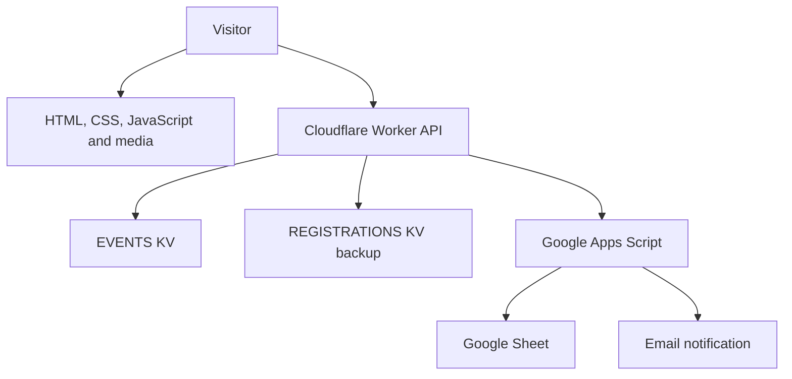

# Architecture

The site uses plain HTML, custom CSS/JavaScript, and a Cloudflare Worker. There is no repository package manifest, build pipeline, or test suite.

| Component | Source |
| --- | --- |
| Worker API | `src/worker.js` |
| Worker and asset configuration | `wrangler.jsonc` |
| Shared styling | `custom/css/style.css` |
| Shared browser behavior | `custom/js/site.js` |
| Calendar UI | `custom/js/calendar.js` |
| Registration UI | `custom/js/register.js` |
| Google integration | `google-apps-script/Code.gs` |

`ASSETS` serves static files; `/api/*` runs the Worker first. The site loads Bootstrap 5.3.3 from jsDelivr and Nunito from Google Fonts.

See [[Site Map]], [[Calendar Operations]], and [[Registration and Email]].
